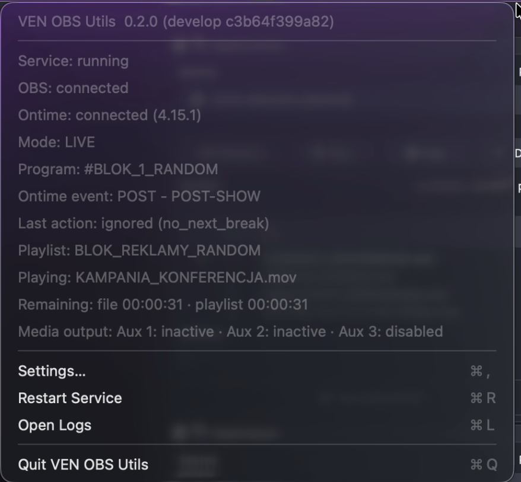
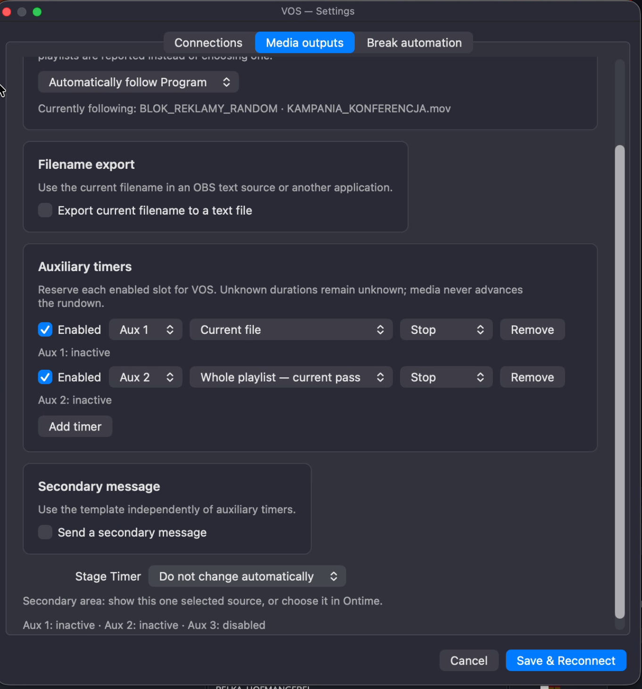

# VEN OBS Utils

A small macOS menu-bar utility for OBS and Ontime break automation, MPS media
countdowns, and filename export. Built for my own live-production setup with
AI-assisted coding. This is not an official OBS or Ontime project.

## Break automation

Switch OBS Program to a break scene and VOS starts the next break in Ontime.
Switch back and it moves to the next event, provided Ontime is still on a break.
Choose which scenes and CUEs count as breaks in Settings.

Preview changes are ignored. Skipped events and milestones are passed over,
and reconnecting does not replay missed scene changes.

## Media outputs

Use [Media Playlist Source (MPS)](https://github.com/Vencite/media-playlist-source),
my OBS playlist plugin, to send current-file or playlist time to up to three
Ontime auxiliary timers. You can also send a secondary message or export the
current filename to TXT. Follow the source in Program or choose a fixed one;
all outputs are optional and off by default.

[Media setup and testing →](MEDIA-BRIDGE.md)

## Download and install

Requires **macOS 13+**, **Python 3**, [OBS Studio](https://obsproject.com/) and
[Ontime](https://www.getontime.no/). OBS WebSocket is built into OBS 28+;
Advanced Scene Switcher is not required.

[Download the latest release](https://github.com/Vencite/ven-obs-utils/releases/latest),
open the DMG and drag **VEN OBS Utils** to Applications. A ZIP is also available.
Prebuilt apps do not require Xcode. See [what’s new in 0.3.0](CHANGELOG.md).

Builds are ad-hoc signed, without Apple notarization. If macOS blocks the app,
allow it in **System Settings → Privacy & Security**.

## Settings and status

Open **Settings…** from the menu bar to connect OBS and Ontime, choose media
outputs and set up break automation. The menu shows connections, media time
and the last action.

Start with **Dry run** to check your setup without changing Ontime (TXT export
still writes files). Updating the app keeps your settings and OBS password.

## In use

<table>
  <tr>
    <td width="40%" valign="top"></td>
    <td width="60%" valign="top"></td>
  </tr>
  <tr>
    <td>Connection and playback status in the menu bar.</td>
    <td>Independent media outputs. Screenshots from a develop build.</td>
  </tr>
</table>

## Developer documentation

See [building, testing and local HTTP triggers](docs/DEVELOPMENT.md) for source
builds, test commands and authenticated integrations such as Companion.

## License and contact

MIT. See [LICENSE](LICENSE). Issues and sensible PRs are welcome.

For live production, video, photography or 3D work:
[VEN.WORKS — English](https://ven.works/en/) · [Polish](https://ven.works/).
